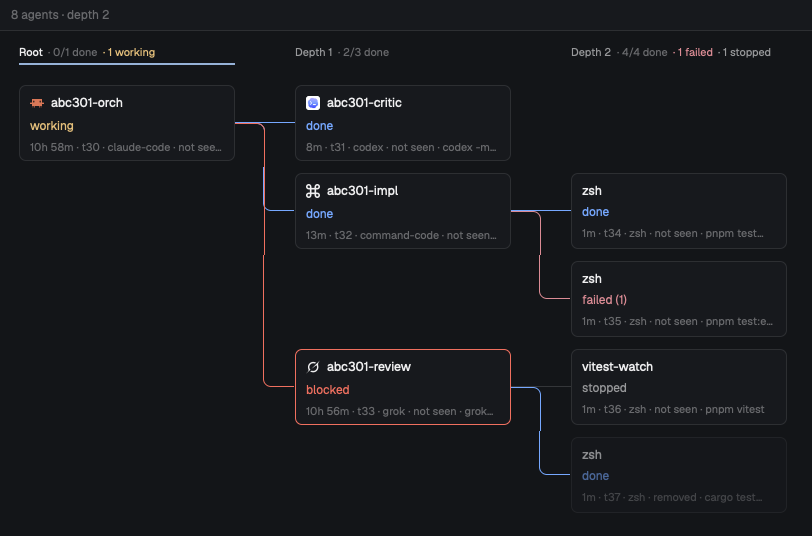

# Agent graph

A side panel that draws the shown tab's agents as a spawn tree: the agent you started on the
left, every sub-agent it ran (`hc run`) one column to the right, their own sub-agents further
right. Each card says what the agent is, how it stands or how it ended, and for how long. It
updates by itself while shown and follows the tab you switch to. A small background recorder
keeps a history of every terminal, so agents that already finished, or were removed with `hc rm`,
still show in the tree. Clicking a live card peeks at its terminal; clicking a finished Claude
Code, Codex, Grok, Command Code, Copilot CLI or OpenCode card resumes that exact session in a new
tab.

## What you see

Top to bottom, filling its block (designed for a ~368 px side panel, works up to full width):

- **Bar**, 32 px, `surface` background with a 1 px `border` line under it, 12 px text, 12 px
  side padding, items 8 px apart:
  - left: dim (`dim`) bits, the first plain and the rest written `· text`:
    `5 agents · depth 2`, `centred on the deepest working agent` after Center, `3 not drawn`
    when cards were skipped, `no recorded history yet` when the history file doesn't exist, or
    the read or parse error. No space or tab name: the window already shows those.
  - right: three 14 px icon buttons, 6×4 px padding, 5 px corners, `muted` at rest, `hover`
    background and `foreground` on hover, half opacity and inert when disabled: Center
    (`icons/crosshair.svg`, enabled when something is working), Reset view (`icons/undo.svg`,
    enabled when scrolled away from the top-left), Close (Herdr's
    `mods/workspace-chrome/x.svg`).
- **Canvas** below, `canvas` background, a fixed viewport over the graph (no native scrollbar):
  - **Column headers**, 34 px tall, 12 px top padding, 11 px text, one per column over its
    cards: `Root` or `Depth N` (`foreground` on the active depth, else `muted`), then
    `· k/n done` (`dim`), `· N working` (`working`), `· N failed` (`ansi1`),
    `· N stopped` (`muted`). The active depth (the deepest column with a working agent) gets a
    2 px `accent` underline. A column of only removed-before-recording parents says
    `removed before recording`.
  - **Cards**, 216×76 px, 7 px corners, 1 px border, 10×7 px padding, 3 px row gap, columns
    60 px apart, rows 12 px apart, 20 px canvas padding. `background` fill, `border` border
    (`blocked` when the agent is blocked or errored). Three lines:
    1. title, 12.5 px medium, truncated, after a 14 px program icon (tinted `foreground` if the
       icon is one-color): a live card's program icon, or a recorded agent's logo (Claude Code,
       Codex, Grok, Command Code, ...) from Herdr's agent table. Other recorded cards have none.
    2. the status word, colored by kind: `working` (`working`), `blocked` (`blocked`,
       semibold), `error` (`blocked`, semibold), `done` (`done`), `idle` (`dim`),
       `failed (1)` (`ansi1`), `stopped` (`muted`), `ended` (`dim`), `running` (`muted`).
    3. meta, 11 px `dim`, truncated, joined by ` · `: duration (`42s`, `5m`, `1h 3m`,
       `2d 4h`; one still running says `<1m` for its first minute, then counts up a minute at
       a time), address (`t7`), program, `removed`, `not seen`, then the command when it says
       more than the program.
    - A removed terminal's card is at 55% opacity.
    - A parent the history never saw is a dashed `input`-bordered card showing its address
      and `removed before recording`.
  - **Links**, 1.5 px, from a parent's right edge to each child's left edge: across, down or up
    with 8 px rounded corners, across. Colored by the child: `working`, `blocked` (blocked or
    error), `ansi1` (failed), `done`, else `input`.
- **Empty**: with no agents, the bar plus 24 px padded `dim` text: `No agents in this tab yet.`
  Blank until the first load has finished, so it never flashes.

## How it behaves

- **Live, and quiet.** While shown, the graph follows agents starting, changing status,
  finishing and being removed, and new history records, with no Refresh. It redraws only when
  something it draws changed: a status or title tick that changes nothing visible does no work.
  Hidden, it does nothing and catches up when shown again.
- **Which agents.** The shown tab of the active space: the live terminals in its panes, those
  labelled `herdr.tab=<its id>`, and all their descendants by `parent`, plus recorded terminals
  whose `where` label is `<space name> / <tab name>`. Switching tabs or spaces switches the
  graph. A run is a root with descendants; a lone live agent (it reports a status or is a known
  agent) is a run of one. The graph shows the first run, ordered live-working runs first, then
  most recent activity.
- **Statuses.** Live data wins over the record. Live: its status word (`working`, `blocked`,
  `idle`, `done`, ...) or `running` for a plain program; `ended` if it was removed while live.
  Finished: `stopped` (killed), `done` (exit 0), `failed (N)`, else `ended`.
- **k/n done** counts finished terminals, `done` agents, and `idle` agents that either have
  children or were seen `working` before (remembered in `localStorage`, last 2000 ids).
- **Scroll** pans the viewport (Shift+wheel pans sideways), clamped to the graph's edges, and
  stays smooth on big graphs: panning moves already-built cards and rebuilds them only near the
  edge of what was built. Center puts the active depth's top working card in the middle; Reset
  goes back to the top-left.
- **Card budget.** Cards are built for the viewport plus a margin (one column, two rows), at
  most 28: those in view first, then nearest the centre; the root and the active depth's card
  are always kept. A link to a skipped parent becomes a 24 px stub.
- **Click** a live card: `terminal.peek`. Click a finished resumable card: `resume.py` finds
  its session and `tab.new {name, folder, argv}` runs `claude --resume <id>`,
  `codex resume <id>`, `cmd --resume <id>`, `grok --resume <id>`, `copilot --resume <id>` or
  `opencode --session <id>` in its folder. When the exact session can't be found, the agent's own
  picker opens and a toast says so (Grok and OpenCode have no picker flag: a toast explains).
  Other cards don't respond. Hovering a clickable card turns its border `accent`.
- **Escape** (while focused), Close, or the `close` mod command hides the layout node the graph
  sits in: the recipe's `panel`, or the block's own `props.hide` when a layout gives the graph its
  own node (e.g. its own column).
  Any other mod command (`agent-graph.<anything>`) rereads the history and redraws.
- **Opening.** Setting shared `"agent-graph.shown"` to a new value (e.g. `Date.now()`) focuses
  the graph and brings it up to date; the opener also selects and shows its block.

## Built from

- **Layout.** A block `{ "id": "graph", "content": { "mod": "agent-graph" } }`. In the build
  this came from it is a child of a stack `panel-body` (beside Herdr's `files` and `changes`)
  inside a hidden column `panel` (368 px, min 280, max 900) on the right of a clone of `main`.
  The mod renders nothing while node `graph` is off screen (it or an ancestor hidden, or a
  stack showing another child); with no node `graph` in the layout (a pane, a check run) it
  always draws. `mod.json`: `{ "place": "none", "title": "Agent graph" }`.
- **Opener** (in another mod: a tab-bar button, a palette entry):
  `setShared("agent-graph.shown", Date.now()); run("layout.select", { stack: "panel-body", child: "graph" }); run("layout.show", { id: "panel" });`
- **Props:** `history` (optional): the history file to read; default
  `~/.local/share/herdr-agent-graph/history.json`. An absolute path is used as given, a
  relative one from the mod's folder. Point it at `fixtures/*.json` to try the view without
  the recorder. `hide` (optional): the layout node Close/Escape hide; default `panel`. Set it when
  the layout puts the graph somewhere else, e.g. a dedicated column:
  `{ "mod": "agent-graph", "props": { "hide": "graph-panel" } }`.
- **`main.js`**: the view. `herdr`: `terminals`, `spaces`, `panes`, `theme`, `run`, `props`,
  `home`, `appHome`, `readTextFile`, `watchFolder`, `knownAgents`, `nextCommand`, `shared`,
  `exec`, `notify`, `layout`. `knownAgents()` (once, at start) gives recorded cards their
  agent's icon by table key or icon name, after mapping hc's agent words that differ
  (`claude-code` to `claude`, `grok-build` to `grok`, `cmd` to `command-code`); a pass is then
  forced, since logos aren't among the inputs the coordinator compares. Commands: `layout.hide`, `terminal.peek`, `tab.new`. Cards and links live in a
  retained child view (`cx.new(Slab)`), rebuilt with `set_props` only when what it draws
  changed; a pan only moves its wrapper. A shown render compares a string key of the tab and
  its terminals (never titles) with the one the graph was built from. A minute timer redraws
  only the child (`cx.notify(slab)`), and only when a drawn duration would read differently.
- **`live.js`**: the one coordinator every update goes through: the first load, render-noticed
  changes, the history watcher (`watchFolder` on the history's folder, matched by file name so
  the recorder's temp files don't count; retried every 5 s, rereading while shown), showing,
  switching, key commands. One pass at a time over one snapshot of its inputs; a newer pass
  wins; an equal result publishes nothing; a pass stuck over 10 s is retired.
- **`model.js`**: pure functions: history parse, merging records with live terminals by id
  (`<address>@<created_ms>`), parent resolution, ghosts, cycle cutting, run ordering, card
  facts, and the layout (column = depth, children under their parent in spawn order so links
  never cross).
- **`recorder.py`** (Python 3, standard library): follows `hc events --json`, re-reads
  `hc ls --all --json` every 15 s, and writes `history.json` atomically as described in
  `FORMAT.md` (14 days; non-current records capped at 1500; always under 900 KB). An unreadable
  or wrong-version history is kept aside as `history.json.bad-<time>` rather than overwritten.
  `install.sh` installs it as a
  macOS launchd agent (`dev.herdr.agent-graph-recorder`, `/usr/bin/python3 -I`, logs to
  `~/.local/share/herdr-agent-graph/recorder.log`); `uninstall.sh` removes it and keeps the
  history.
- **`resume.py`**: given the history and a record id, finds that run's session by folder and
  start time in `~/.claude/projects`, `~/.codex/sessions`, `~/.commandcode/projects`,
  `~/.grok/sessions`, `~/.copilot/session-state/*/workspace.yaml`, or OpenCode's
  `~/.local/share/opencode/opencode.db` (`session` table), and prints `{argv, cwd, session}` or
  `{error}`. Read-only (the OpenCode db is opened `mode=ro`; a live SQLite read may take a shared
  lock).
- **Tests:** `python3 -m unittest recorder_test resume_test` and `node live_test.mjs` (the
  coordinator against fake host data, a fake clock and controlled reads). **Fixtures:**
  `fixtures/*.json` are sample histories (a `/fusion` run, a removed parent, reused
  addresses, idle agents, a 28-card overflow).
- **Art:** `icons/crosshair.svg`, `icons/undo.svg` (24×24 stroke icons, tinted).

## Watch out

- **What it reaches:** runs programs (`python3` for `resume.py`; the recorder runs `hc`), reads
  files outside its folder (the history under `~/.local/share/herdr-agent-graph/`, and
  agents' session stores under `~/.claude`, `~/.codex`, `~/.commandcode`, `~/.grok`, `~/.copilot`
  and OpenCode's `~/.local/share/opencode/opencode.db` when resuming). No network.
- `install.sh` is macOS-only (launchd). On Linux run `python3 -I recorder.py` under a systemd
  user service or similar. Without the recorder the graph still shows live terminals.
- The mod hides the node id `panel` (Close, Escape). If your layout puts the graph elsewhere, set
  the block's `props.hide` to that node (or change `hideNode()` in `main.js`).
- It needs an opener: nothing in this folder opens the panel. Add the opener above to a mod or a
  palette entry (a `keys.json` key can't set shared state and show a node at once).
- A fresh mod copy is cold and can stall the window for seconds; keep one long-lived copy in the
  layout (a hidden stack child) rather than opening it as an overlay each time.
- Herdr calls `render()` on every live-data change, title ticks included, and there is no
  terminal subscription: render is the only signal. Keep render to a key comparison and do the
  work off the render path (`cx.spawn`); render must not call `cx.notify` or `set_props`.
- The app interrupts a frame that builds too many native elements: keep the 28-card budget, and
  never rebuild cards on a pan (a wheel event per frame in an interpreter is what made scrolling
  lag).
- `on_size_change` must ignore same-size reports, or it renders in a loop.
- A zero-height div with a border paints nothing: draw straight links as a filled bar.
- Addresses are reused after `hc rm`: key everything by `<address>@<created_ms>`.
- Recorded runs match their tab by name, and a tab nobody named is called by its position
  (`1`, `2`), so closing or moving tabs can attach old records to another tab. Live terminals
  match by tab id and aren't affected.
- Resuming picks the earliest session that started in the record's folder after it was created
  and before the next run of the same agent there; two sessions with the same start resume to
  the picker.

## Done when

- `herdr-app check mods/agent-graph` passes, `python3 -m unittest recorder_test resume_test`
  passes (27 tests), and `node live_test.mjs` passes (18 tests).
- With `props: { history: "<abs path>/fixtures/review.json" }` in a space named `example-app`
  on a tab named `review`, the graph shows a `/fusion` run: `abc301-orch` (Claude Code on
  opus-5.5, `working`) as Root; in Depth 1 `abc301-critic` (Codex, `done`), `abc301-impl`
  (Command Code, `done`) and `abc301-review` (Grok, `blocked` with a `blocked` border), each
  with its agent's logo; in Depth 2 four test runs (`done`, `failed (1)` under the
  implementer; `stopped`, `done` and removed under the reviewer).
- After `install.sh`, `~/.local/share/herdr-agent-graph/history.json` appears and grows when you
  run `hc run -- sleep 1`.
- Starting a sub-agent with `hc run` from a tab's shell adds a card one column right of its
  parent, linked to it, within a second and without any click; killing it turns the card
  `stopped`. Clicking a live card peeks at the terminal.
- With two tabs each running a sub-agent, each tab's graph shows only its own, switching tabs
  switches the graph, and a change in the other tab leaves the shown graph alone.
- After a Claude Code sub-agent exits, clicking its card opens a new tab running
  `claude --resume <its session>` in its folder; the same works for Codex, Command Code, Grok,
  Copilot CLI and OpenCode.
- Scroll pans smoothly on a big graph; Center and Reset move the view; Escape hides the panel.
