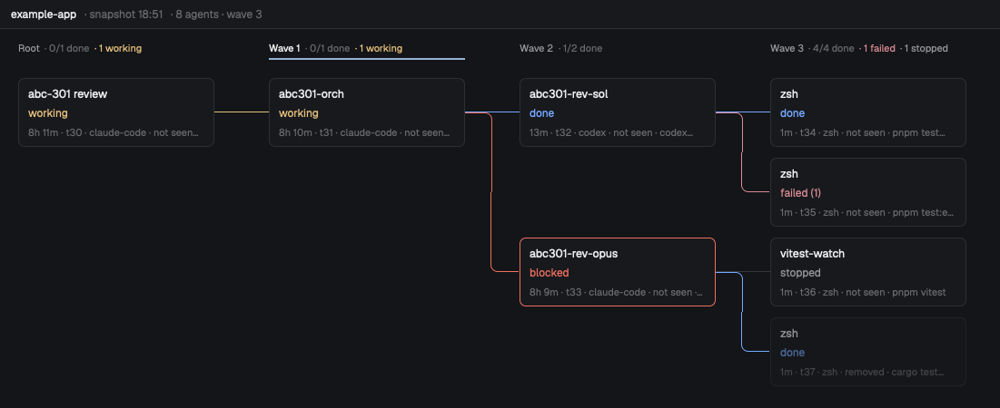

# Agent graph

A side panel that draws the active space's agents as a spawn tree: the agent you started on the
left, every sub-agent it ran (`hc run`) one column to the right, their own sub-agents further
right. Each card says what the agent is, how it stands or how it ended, and for how long. A small
background recorder keeps a history of every terminal, so agents that already finished, or were
removed with `hc rm`, still show in the tree. Clicking a live card peeks at its terminal;
clicking a finished Claude Code, Codex, Grok or Command Code card resumes that exact session in a
new tab.

## What you see

Top to bottom, filling its block (designed for a ~368 px side panel, works up to full width):

- **Bar**, 32 px, `surface` background with a 1 px `border` line under it, 12 px text, 12 px
  side padding, items 8 px apart:
  - left: the space's name (semibold, `foreground`, at most 160 px, truncated), then dim
    (`dim`) bits each written `· text`: `snapshot 14:32` (or `Oct 30 14:32` on another day),
    `5 agents · wave 2`, `centred on the active wave` after Center, `3 not drawn` when cards
    were skipped, `no recorded history yet` when the history file doesn't exist, or the read or
    parse error.
  - right: four 14 px icon buttons, 6×4 px padding, 5 px corners, `muted` at rest, `hover`
    background and `foreground` on hover, half opacity and inert when disabled: Refresh
    (`icons/refresh.svg`), Center active wave (`icons/crosshair.svg`, enabled when something is
    working), Reset view (`icons/undo.svg`, enabled when scrolled away from the top-left), Close
    (Herdr's `mods/workspace-chrome/x.svg`).
- **Canvas** below, `canvas` background, a fixed viewport over the graph (no native scrollbar):
  - **Column headers**, 34 px tall, 12 px top padding, 11 px text, one per column over its
    cards: `Root` or `Wave N` (`foreground` on the active wave, else `muted`), then
    `· k/n done` (`dim`), `· N working` (`working`), `· N failed` (`ansi1`),
    `· N stopped` (`muted`). The active wave (the deepest column with a working agent) gets a
    2 px `accent` underline. A column of only removed-before-recording parents says
    `removed before recording`.
  - **Cards**, 216×76 px, 7 px corners, 1 px border, 10×7 px padding, 3 px row gap, columns
    60 px apart, rows 12 px apart, 20 px canvas padding. `background` fill, `border` border
    (`blocked` when the agent is blocked or errored). Three lines:
    1. title, 12.5 px medium, truncated; a live card shows its program's 14 px icon before it
       (tinted `foreground` if the icon is one-color).
    2. the status word, colored by kind: `working` (`working`), `blocked` (`blocked`,
       semibold), `error` (`blocked`, semibold), `done` (`done`), `idle` (`dim`),
       `failed (1)` (`ansi1`), `stopped` (`muted`), `ended` (`dim`), `running` (`muted`).
    3. meta, 11 px `dim`, truncated, joined by ` · `: duration (`42s`, `5m`, `1h 3m`,
       `2d 4h`; running ones count up to now), address (`t7`), program, `removed`,
       `not seen`, then the command when it says more than the program.
    - A removed terminal's card is at 55% opacity.
    - A parent the history never saw is a dashed `input`-bordered card showing its address
      and `removed before recording`.
  - **Links**, 1.5 px, from a parent's right edge to each child's left edge: across, down or up
    with 8 px rounded corners, across. Colored by the child: `working`, `blocked` (blocked or
    error), `ansi1` (failed), `done`, else `input`.
- **Empty**: with no agents, the bar plus 24 px padded `dim` text: `No agents in this space yet.
  Refresh after one starts another.`

## How it behaves

- **A snapshot, not a feed.** The history file and Herdr's `terminals()` are read when the panel
  opens, when the active space changes while it shows, and on Refresh. Nothing polls and
  nothing animates; status changes show on the next refresh.
- **Which agents.** The active space's live terminals (those in its tabs' panes, those labelled
  `herdr.space=<its id>`, and all their descendants by `parent`), plus recorded terminals whose
  `where` label starts with the space's name. A run is a root with descendants; a lone live
  agent (it reports a status or is a known agent) is a run of one. The graph shows the first
  run, ordered live-working runs first, then most recent activity.
- **Statuses.** Live data wins over the record. Live: its status word (`working`, `blocked`,
  `idle`, `done`, ...) or `running` for a plain program; `ended` if it was removed while live.
  Finished: `stopped` (killed), `done` (exit 0), `failed (N)`, else `ended`.
- **k/n done** counts finished terminals, `done` agents, and `idle` agents that either have
  children or were seen `working` before (remembered in `localStorage`, last 2000 ids).
- **Scroll** pans the viewport (Shift+wheel pans sideways), clamped to the graph's edges.
  Center puts the active wave's top working card in the middle; Reset goes back to the
  top-left.
- **Card budget.** Only cards crossing the viewport are built, at most 28, nearest the centre
  first; the root and the active wave's card are always kept. A link to a skipped parent
  becomes a 24 px stub.
- **Click** a live card: `terminal.peek`. Click a finished resumable card: `resume.py` finds
  its session and `tab.new {name, folder, argv}` runs `claude --resume <id>`,
  `codex resume <id>`, `cmd --resume <id>` or `grok --resume <id>` in its folder. When the
  exact session can't be found, the agent's own picker opens and a toast says so (Grok has no
  picker: a toast explains). Other cards don't respond. Hovering a clickable card turns its
  border `accent`.
- **Escape** (while focused), Close, or the `close` mod command hides the layout node `panel`.
  Any other mod command (`agent-graph.<anything>`) refreshes.
- **Opening.** Setting shared `"agent-graph.shown"` to a new value (e.g. `Date.now()`)
  refreshes and focuses the graph; the opener also selects and shows its block.

## Built from

- **Layout.** A block `{ "id": "graph", "content": { "mod": "agent-graph" } }`. In the build
  this came from it is a child of a stack `panel-body` (beside Herdr's `files` and `changes`)
  inside a hidden column `panel` (368 px, min 280, max 900) on the right of a clone of `main`.
  The mod renders nothing while node `graph` is off screen (it or an ancestor hidden, or a
  stack showing another child); with no node `graph` in the layout (a pane, a check run) it
  always draws. `mod.json`: `{ "place": "none", "title": "Agent graph" }`.
- **Opener** (in another mod: a tab-bar button, a palette entry):
  `setShared("agent-graph.shown", Date.now()); run("layout.select", { stack: "panel-body", child: "graph" }); run("layout.show", { id: "panel" });`
- **Props:** `history` (optional): the history file to read; default
  `~/.local/share/herdr-agent-graph/history.json`. Point it at `fixtures/*.json` to try the
  view without the recorder.
- **`main.js`**: the view. `herdr`: `terminals`, `spaces`, `panes`, `theme`, `run`, `props`,
  `home`, `appHome`, `readTextFile`, `nextCommand`, `shared`, `exec`, `notify`, `layout`.
  Commands: `layout.hide`, `terminal.peek`, `tab.new`. The load runs in `cx.spawn`, yields
  with `cx.sleep(0)` between steps, and a 10 s watchdog retries a load that never finished.
- **`model.js`**: pure functions: history parse, merging records with live terminals by id
  (`<address>@<created_ms>`), parent resolution, ghosts, cycle cutting, run ordering, card
  facts, and the layout (column = depth, children under their parent in spawn order so links
  never cross).
- **`recorder.py`** (Python 3, standard library): follows `hc events --json`, re-reads
  `hc ls --all --json` every 15 s, and writes `history.json` atomically as described in
  `FORMAT.md` (14 days, at most 1500 records, under 900 KB). `install.sh` installs it as a
  macOS launchd agent (`dev.herdr.agent-graph-recorder`, `/usr/bin/python3 -I`, logs to
  `~/.local/share/herdr-agent-graph/recorder.log`); `uninstall.sh` removes it and keeps the
  history.
- **`resume.py`**: given the history and a record id, finds that run's session by folder and
  start time in `~/.claude/projects`, `~/.codex/sessions`, `~/.commandcode/projects` or
  `~/.grok/sessions` and prints `{argv, cwd, session}` or `{error}`. Read-only.
- **Tests:** `python3 -m unittest recorder_test resume_test`. **Fixtures:** `fixtures/*.json`
  are sample histories (a review fan-out, a removed parent, reused addresses, idle agents, a
  28-card overflow).
- **Art:** `icons/refresh.svg`, `icons/crosshair.svg`, `icons/undo.svg` (24×24 stroke icons,
  tinted).

## Watch out

- **What it reaches:** runs programs (`python3` for `resume.py`; the recorder runs `hc`), reads
  files outside its folder (the history under `~/.local/share/herdr-agent-graph/`, and
  agents' session stores under `~/.claude`, `~/.codex`, `~/.commandcode`, `~/.grok` when
  resuming). No network.
- `install.sh` is macOS-only (launchd). On Linux run `python3 -I recorder.py` under a systemd
  user service or similar. Without the recorder the graph still shows live terminals.
- The mod hides the node id `panel` (Close, Escape). If your layout puts the graph elsewhere,
  change `hide()` in `main.js`.
- It needs an opener: nothing in this folder opens the panel. Add the opener above to a mod or a
  palette entry (a `keys.json` key can't set shared state and show a node at once).
- A fresh mod copy is cold and can stall the window for seconds; keep one long-lived copy in the
  layout (a hidden stack child) rather than opening it as an overlay each time.
- Never re-render on `terminals()` title ticks: the view only reads live data in `load()`.
  Reading it in `render()` makes every title change rebuild the graph.
- `on_size_change` must ignore same-size reports, or it renders in a loop.
- A zero-height div with a border paints nothing: draw straight links as a filled bar.
- Addresses are reused after `hc rm`: key everything by `<address>@<created_ms>`.
- Resuming picks the earliest session that started in the record's folder after it was created
  and before the next run of the same agent there; two sessions with the same start resume to
  the picker.

## Done when

- `herdr-app check mods/agent-graph` passes, and `python3 -m unittest recorder_test resume_test`
  passes (20 tests).
- With `props: { history: "<abs path>/fixtures/review.json" }` in a space named `example-app`,
  the graph shows `abc-301 review` as Root, `abc301-orch` in Wave 1, two reviewers in Wave 2
  (`abc301-rev-sol` `done`, `abc301-rev-opus` `blocked` with a `blocked` border) and four test runs in Wave 3 (`done`, `failed (1)`,
  `stopped`, `done`).
- After `install.sh`, `~/.local/share/herdr-agent-graph/history.json` appears and grows when you
  run `hc run -- sleep 1`.
- Starting a sub-agent with `hc run` and pressing Refresh adds a card one column right of its
  parent, linked to it; clicking it peeks at the terminal.
- After a Claude Code sub-agent exits, clicking its card opens a new tab running
  `claude --resume <its session>` in its folder.
- Scroll pans; Center and Reset move the view; Escape hides the panel.
